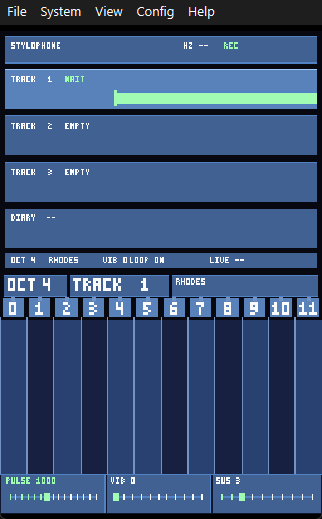
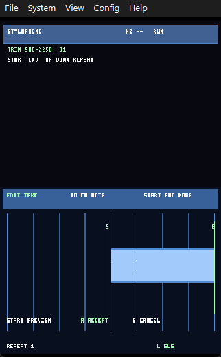
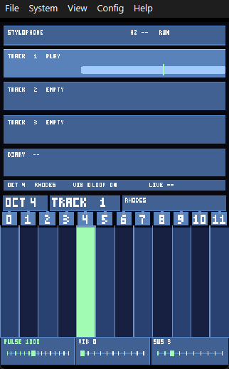

# Manual práctico: grabar, aceptar y editar una frase

Este documento describe el flujo completo para crear una frase en DS Stylophone / Looper, corregir sus notas y aceptarla en una pista.

> Las capturas se han obtenido de la ROM canónica ejecutada en melonDS. La edición de notas de la captura recién grabada y el selector de frases reutilizan el mismo editor. La validación final del gesto en hardware debe hacerse en la DSi.

## 1. Preparar la grabación

1. Selecciona la pista con `←` y `→`.
2. Pulsa `A`.
3. La pista entra en estado `WAIT`. La captura ya está abierta, pero todavía no se ha guardado ninguna frase.



En `WAIT` puedes preparar el gesto y empezar a tocar cuando quieras. El silencio entre la apertura con `A` y la primera nota forma parte de la captura.

## 2. Tocar la frase

Toca las franjas numeradas `0..11` de la pantalla inferior. Puedes tocar notas separadas o deslizar el stylus entre franjas.

- La altura se obtiene de la octava seleccionada.
- El timbre actual se conserva en cada nota grabada.
- Si mantienes `L`, la nota recuerda que debe tener sustain.
- El metrónomo no emite sonido. `PULSE` solo proporciona el reloj interno para las marcas y el snap.

Cuando termines, pulsa `A` otra vez. La grabación se cierra y aparece el editor de aceptación. La frase todavía no se ha añadido a la pista.

## 3. Entender el editor de aceptación

En la pantalla de aceptación, cada nota aparece como un bloque horizontal. La posición horizontal representa el tiempo y la anchura representa la duración.



Los controles principales son:

| Zona o botón | Acción |
| --- | --- |
| Centro del bloque | Selecciona y mueve la nota completa. |
| Borde izquierdo | Cambia el inicio (`START`) de la nota. |
| Borde derecho | Cambia el final (`END`) de la nota. |
| Marca `S` | Indica que la nota tiene sustain activado. |
| `START` | Reproduce o detiene la preview de la captura. |
| `A` | Acepta la frase y la añade a la pista. |
| `B` | Cancela y recupera la captura original. |
| `L` corto | Activa o desactiva el sustain de la nota seleccionada. |
| `↑` / `↓` | Cambia el número de repeticiones. |

## 4. Mover y alargar una nota

1. Toca el centro del bloque.
2. Mantén el stylus pulsado y arrastra horizontalmente.
3. Mientras arrastras, la nota sigue el movimiento libremente.
4. Al levantar el stylus, el inicio se ajusta al cuarto de pulso más cercano.

Para cambiar la duración:

- Arrastra el borde izquierdo para modificar `START`.
- Arrastra el borde derecho para modificar `END`.
- Al soltar, el borde se ajusta a la rejilla de cuartos de pulso.

El editor evita duración cero, salida del rango y solapamiento con las notas vecinas. Los silencios permanecen como huecos: mover una nota no hace ripple automático sobre las siguientes.

## 5. Activar o quitar sustain

1. Selecciona una nota tocándola.
2. Pulsa `L` una vez, sin mantenerlo.
3. Si aparece `S`, esa nota conservará su sustain durante la reproducción.
4. Pulsa `L` de nuevo para quitarlo.

El sustain de cada nota es independiente del sustain de las demás. El nivel utilizado es el valor actual de `SUS`.

## 6. Ajustar los límites de la frase

Los tiradores finos `S` y `E` de la franja superior recortan el principio y el final de toda la captura:

- Arrastra `S` para eliminar silencio inicial.
- Arrastra `E` para eliminar silencio final.
- No cruces `START` y `END`.

Estos límites no cambian el pitch de las notas. Solo cambian el rango temporal que se escucha y el origen de la frase aceptada.

## 7. Escuchar antes de aceptar

Pulsa `START` para escuchar la preview. La barra verde muestra la posición actual dentro del rango editado.

Puedes detenerla pulsando `START` otra vez y seguir editando. Si la preview no te convence, realiza los cambios y vuelve a reproducirla.

## 8. Aceptar o cancelar

Cuando el resultado sea correcto, pulsa `A`.

La frase se añade al final de la pista seleccionada. La pantalla vuelve al modo normal y el monitor superior muestra la frase aceptada.



Si no quieres conservarla, pulsa `B` desde el editor. La captura se descarta y los tiempos originales se recuperan exactamente.

## 9. Editar una frase ya aceptada con `SELECT`

Mantén `SELECT` para abrir el selector de frases. El teclado queda arriba y abajo aparecen tres filas, una por pista, con sus cajas de frases.

1. Toca la caja de la frase que quieres modificar.
2. Se abre el mismo editor de aceptación, con los mismos bloques de notas.
3. Mueve notas, cambia sus bordes, ajusta `S`/`E` y modifica sustain igual que en una captura nueva.
4. Pulsa `A` para reemplazar esa frase o `B` para cancelar.

Si la frase tiene repeticiones, se edita la fuente y el cambio se refleja en todas ellas. No se edita la pista completa ni se usa un playhead global.

## 10. Resumen rápido

```text
←/→ seleccionar pista
A       abrir captura
tocar   grabar notas
A       cerrar captura y abrir aceptación
centro  mover nota
borde   cambiar START o END
L       activar/desactivar sustain de la nota
START   escuchar preview
A       aceptar frase
B       cancelar
```
